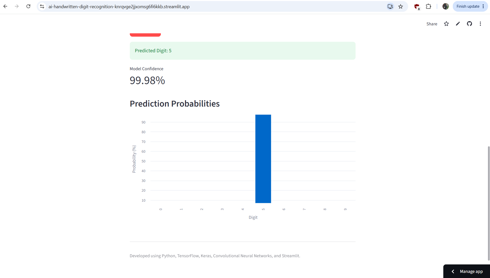
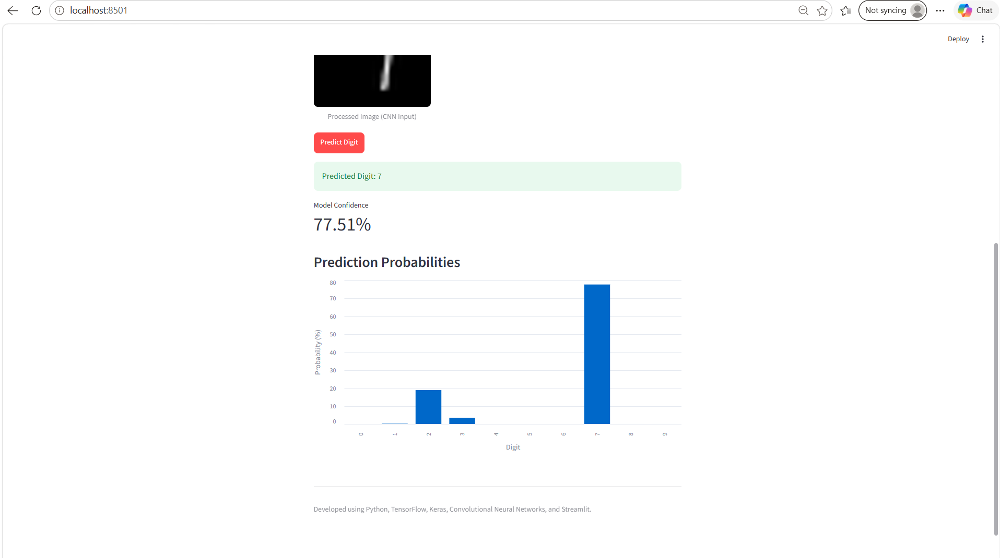

# AI-Based Handwritten Digit Recognition

An end-to-end Deep Learning project that recognizes handwritten digits (0–9) using a Convolutional Neural Network (CNN), with an interactive web application developed using Streamlit.

## Live Application

Try the deployed AI-Based Handwritten Digit Recognition System:

[Launch the Streamlit App](https://ai-handwritten-digit-recognition-knrqvge2jjxomsg6fi6kkb.streamlit.app)

## Project Overview

This project demonstrates how deep learning and computer vision can be used to recognize handwritten digits from uploaded images.

The system processes the uploaded image, passes it through a trained CNN model, and displays the predicted digit along with the model's confidence score and class probabilities.

## Technologies Used

- Python
- TensorFlow and Keras
- Convolutional Neural Networks (CNN)
- NumPy
- Pandas
- Pillow
- Matplotlib and Seaborn (model analysis)
- Jupyter Notebook
- Streamlit

## Dataset

The project uses the MNIST handwritten digit dataset, containing 70,000 grayscale images of handwritten digits from 0 to 9.

- Training dataset: 60,000 images
- Testing dataset: 10,000 images
- Image dimensions: 28 × 28 pixels

## Project Workflow

1. Load and explore the MNIST dataset.
2. Normalize image pixel values.
3. Build and compile a CNN model.
4. Train the model using the training dataset.
5. Evaluate performance on the test dataset.
6. Analyze predictions using a confusion matrix and classification report.
7. Save the trained CNN model.
8. Build an interactive Streamlit application.
9. Preprocess uploaded images and generate predictions.

## Application Features

- Upload handwritten digit images in PNG or JPG format.
- Automatically preprocess images for CNN input.
- Recognize digits from 0 to 9.
- Display the predicted digit.
- Show model confidence.
- Visualize prediction probabilities for all 10 classes.

## Model Evaluation

The trained CNN was evaluated on the MNIST test dataset using accuracy, precision, recall, F1-score, and a confusion matrix.

The classification report showed approximately 99% overall test accuracy.

Performance on images created outside MNIST may vary because handwriting styles, image quality, and backgrounds can differ.

## Project Structure

```text
AI-Handwritten-Digit-Recognition/
├── app.py
├── digit_recognition.ipynb
├── models/
│   └── mnist_cnn_model.keras
├── requirements.txt
├── .gitignore
└── README.md
```

## How to Run Locally

Install the required libraries:

```bash
pip install -r requirements.txt
```

Launch the Streamlit application:

```bash
streamlit run app.py
```

Open the local address displayed by Streamlit in your browser.

## Example Predictions

| Input digit | Predicted digit | Model confidence |
|---|---|---|
| 7 | 7 | 77.51% |
| 5 | 5 | 99.98% |

These results are examples from manually uploaded images, not a measure of overall application accuracy.

## Future Improvements

- Add a drawing canvas for handwritten digit input.
- Test recognition on more real-world handwriting samples.
- Improve image preprocessing and robustness.
- Deploy the application online.

## Project Purpose

This project demonstrates practical skills in Python, deep learning, computer vision, model evaluation, image preprocessing, and interactive machine-learning application development.


## Application Screenshots

### Handwritten Digit 5 — Application Interface


### Handwritten Digit 5 — Prediction Results


### Handwritten Digit 7 — Application Interface


### Handwritten Digit 7 — Prediction Results


